# claudePet

**Clawd, Claude Code's orange pixel crab, lives on a Stream Deck key and animates along with what Claude Code is doing.**

<p align="center">
  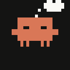
  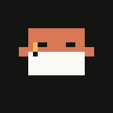
  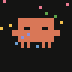
</p>

He reads when Claude reads, scribbles when Claude edits, jumps up and down when Claude needs your permission, dances when a turn is done and falls asleep when you've been away. Press the key to open Claude Code.

> The GIFs here show the art only. On the real key a status line sits under the crab, and mini crabs appear for running subagents.

## How it works

1. **Claude Code hooks** run `hooks/claudepet.sh <Event>` on every event, with the hook's JSON on stdin. The script writes:
   - `~/.claudepet`: the current mood, one word
   - `~/.claudepet-agents/<id>`: one file per running subagent
   - `~/.claudepet-transcript`: the session transcript's path
2. **The plugin** polls those files 5 times per second (one animation frame every 200 ms). Each time the mood changes it picks one of that mood's animation variants at random, so the same activity doesn't always look the same.
3. **The status line** under the crab shows a word with Claude Code's spinner symbol, the dots animating: `✻ Thinking...`, `✶ Reading..`, and so on.
4. **After a turn** it shows `Baked for 1m 52s` (or Brewed, Churned, Cogitated, Cooked, Crunched, Sautéed, Worked), read from the transcript's `turn_duration` entry and computed exactly the way Claude Code does: the same word picked by the same hash, the same duration format. Claude Code only writes that entry for longer turns, so short turns just dance.
5. **Subagents** show up as mini crabs under Clawd, up to 3, each busy out of step with the others.
6. **Pressing Esc** fires no hook in Claude Code, so the plugin watches the transcript for `[Request interrupted by user` and goes back to waiting.

### Tool → mood

| What Claude Code is doing | Mood | Key says |
| --- | --- | --- |
| `Read` | reading | ✻ Reading... |
| `Edit`, `MultiEdit`, `Write`, `NotebookEdit` | editing | ✻ Editing... |
| `Grep`, `Glob` | searching | ✻ Searching... |
| `WebFetch`, `WebSearch` | browsing | ✻ Browsing... |
| `Agent` (`Task`) | delegating | ✻ Delegating... |
| any other tool (`Bash`, MCP tools, ...) | working | ✻ Working... |
| prompt submitted, or a tool just finished | thinking | ✻ Thinking... |
| permission prompt | attention (stays until you answer) | Needs you! |
| a tool failed | oops for 3 s, then back to thinking | Oops... |
| compacting the conversation | compacting | ✻ Compacting... |
| turn done | dancing for 8 s | Baked for 1m 52s |
| session started, turn over, or Esc pressed | idle | Waiting... |
| nothing happened for 5 minutes, or the session ended | sleeping | (nothing) |

Events from inside a subagent only keep its mini crab alive; the big crab always follows the main conversation.

### The key press

- **Short press:** if no Claude Code session is running, opens a new Ghostty window in `~/Development` and runs `claude`; otherwise brings Ghostty to the front (one session is enough). macOS only, needs Ghostty.
- **Hold for half a second:** shows a usage card for 6 seconds: session length, prompts typed, tokens this session (incl. subagents) and tokens today. Tokens = input + cache writes + output, counted once per message; cache reads are left out. No cost is shown because Claude Code only records cost when a session exits. Press again to close the card.

## Setup

You need:

- macOS with the Stream Deck app **7.1 or newer**
- **Node.js 24+**
- **jq** (`/usr/bin/jq` ships with macOS)
- [Ghostty](https://ghostty.org), for the key press

### 1. Build and link the plugin

```sh
npm i -g @elgato/cli
npm install
npm run build
streamdeck link com.alexandru.claudepet.sdPlugin
streamdeck dev        # developer mode; without it `streamdeck restart` does nothing
```

Then quit and reopen the Stream Deck app once, and drag **claudePet → Claude Pet** onto a key.

### 2. Add the hooks

Add this `hooks` block to `~/.claude/settings.json` (merge it with any hooks you already have). The paths assume the repo lives at `~/Development/claudePet`.

```json
{
  "hooks": {
    "SessionStart": [
      { "hooks": [{ "type": "command", "command": "~/Development/claudePet/hooks/claudepet.sh SessionStart" }] }
    ],
    "UserPromptSubmit": [
      { "hooks": [{ "type": "command", "command": "~/Development/claudePet/hooks/claudepet.sh UserPromptSubmit" }] }
    ],
    "PreToolUse": [
      { "matcher": "*", "hooks": [{ "type": "command", "command": "~/Development/claudePet/hooks/claudepet.sh PreToolUse" }] }
    ],
    "PostToolUse": [
      { "matcher": "*", "hooks": [{ "type": "command", "command": "~/Development/claudePet/hooks/claudepet.sh PostToolUse" }] }
    ],
    "PostToolUseFailure": [
      { "matcher": "*", "hooks": [{ "type": "command", "command": "~/Development/claudePet/hooks/claudepet.sh PostToolUseFailure" }] }
    ],
    "Notification": [
      { "matcher": "permission_prompt", "hooks": [{ "type": "command", "command": "~/Development/claudePet/hooks/claudepet.sh Notification" }] }
    ],
    "PreCompact": [
      { "hooks": [{ "type": "command", "command": "~/Development/claudePet/hooks/claudepet.sh PreCompact" }] }
    ],
    "SubagentStart": [
      { "hooks": [{ "type": "command", "command": "~/Development/claudePet/hooks/claudepet.sh SubagentStart" }] }
    ],
    "SubagentStop": [
      { "hooks": [{ "type": "command", "command": "~/Development/claudePet/hooks/claudepet.sh SubagentStop" }] }
    ],
    "Stop": [
      { "hooks": [{ "type": "command", "command": "~/Development/claudePet/hooks/claudepet.sh Stop" }] }
    ],
    "SessionEnd": [
      { "hooks": [{ "type": "command", "command": "~/Development/claudePet/hooks/claudepet.sh SessionEnd" }] }
    ]
  }
}
```

Start a new Claude Code session and Clawd wakes up.

## Animation gallery

Every mood and its variants, at the real key size (144×144, 5 fps). Captions come from the scene code.

<table>
  <tr>
    <th align="left">sleeping</th>
    <td align="center" width="160">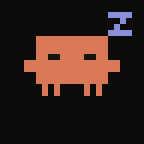<br><sub>breathing slowly, Z's drifting up</sub></td>
    <td align="center" width="160">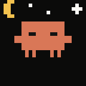<br><sub>under a crescent moon with stars twinkling one after another</sub></td>
    <td align="center" width="160">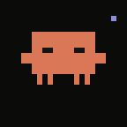<br><sub>a snore bubble inflates beside it, then pops</sub></td>
  </tr>
  <tr>
    <th align="left">listening</th>
    <td align="center" width="160">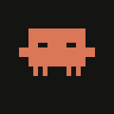<br><sub>looking around, a little hop and a wave now and then</sub></td>
    <td align="center" width="160"><br><sub>a big stretch: claws up, eyes shut, rises on tiptoe, then a blink and back to waiting</sub></td>
    <td align="center" width="160">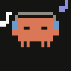<br><sub>headphones on, eyes closed, nodding to the beat while notes float up from both ears</sub></td>
  </tr>
  <tr>
    <th align="left">thinking</th>
    <td align="center" width="160"><br><sub>eyes up at a thought cloud that fills with dots</sub></td>
    <td align="center" width="160">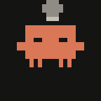<br><sub>a lightbulb flickers above its head, then lights up with rays: idea!</sub></td>
    <td align="center" width="160">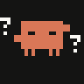<br><sub>question marks float up beside it while it taps its chin with a claw</sub></td>
    <td align="center" width="160">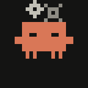<br><sub>two little gears turning above its head</sub></td>
  </tr>
  <tr>
    <th align="left">working</th>
    <td align="center" width="160">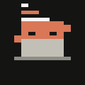<br><sub>typing on a laptop (seen from behind), code scrolling above</sub></td>
    <td align="center" width="160">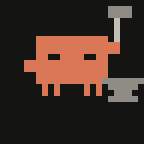<br><sub>hammering on an anvil, sparks flying on each hit</sub></td>
    <td align="center" width="160">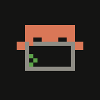<br><sub>terminal window with output appearing and a blinking ">_" prompt</sub></td>
  </tr>
  <tr>
    <th align="left">reading</th>
    <td align="center" width="160">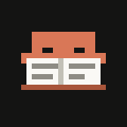<br><sub>open book in front, eyes scanning the lines, a page turning now and then</sub></td>
    <td align="center" width="160">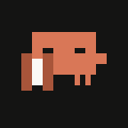<br><sub>unrolling a long scroll from left to right, eyes following the text</sub></td>
    <td align="center" width="160">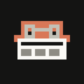<br><sub>little glasses on, reading the morning newspaper</sub></td>
    <td align="center" width="160">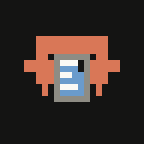<br><sub>scrolling through a tablet, thumb flicking the content upward</sub></td>
  </tr>
  <tr>
    <th align="left">writing</th>
    <td align="center" width="160"><br><sub>pencil writing lines onto a sheet of paper</sub></td>
    <td align="center" width="160">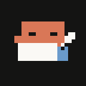<br><sub>dipping a quill in the ink pot, then writing a line</sub></td>
    <td align="center" width="160">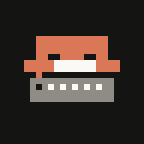<br><sub>clacking away on a typewriter, carriage creeping left, ding at the end</sub></td>
    <td align="center" width="160">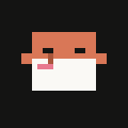<br><sub>painting on a canvas, brush leaving coloured strokes</sub></td>
  </tr>
  <tr>
    <th align="left">searching</th>
    <td align="center" width="160">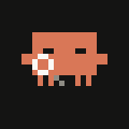<br><sub>magnifying glass sweeping back and forth, eyes following it</sub></td>
    <td align="center" width="160">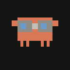<br><sub>binoculars held up to the eyes, panning left and right</sub></td>
    <td align="center" width="160">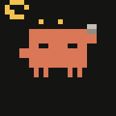<br><sub>flashlight on a raised claw, its spot sweeping the dark until it finds a bug</sub></td>
    <td align="center" width="160">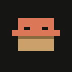<br><sub>rummaging in a box, tossing a Rubik's cube out over its shoulder</sub></td>
  </tr>
  <tr>
    <th align="left">browsing</th>
    <td align="center" width="160">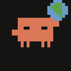<br><sub>holds the Earth up in the right claw, continents turning</sub></td>
    <td align="center" width="160">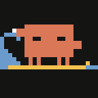<br><sub>surfing the web: riding a board while a wave curls behind</sub></td>
    <td align="center" width="160">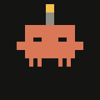<br><sub>antenna on its head, signal arcs pulsing out</sub></td>
  </tr>
  <tr>
    <th align="left">delegating</th>
    <td align="center" width="160">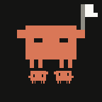<br><sub>waving a flag to send the mini crabs off</sub></td>
    <td align="center" width="160">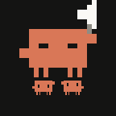<br><sub>shouting orders through a megaphone, sound waves pulsing</sub></td>
    <td align="center" width="160">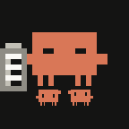<br><sub>ticking items off a clipboard</sub></td>
  </tr>
  <tr>
    <th align="left">oops</th>
    <td align="center" width="160">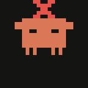<br><sub>a tool failed: a big red ✗ flashes up, the crab flinches with claws up and shakes</sub></td>
  </tr>
  <tr>
    <th align="left">compacting</th>
    <td align="center" width="160">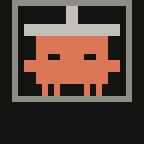<br><sub>a hydraulic press comes down, squashes it flat, then lifts again</sub></td>
    <td align="center" width="160">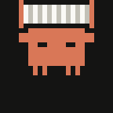<br><sub>squeezing an accordion shut overhead</sub></td>
  </tr>
  <tr>
    <th align="left">attention</th>
    <td align="center" width="160">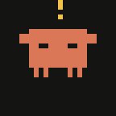<br><sub>needs permission: jumping with a "!"</sub></td>
    <td align="center" width="160">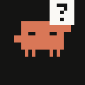<br><sub>holding up a "?" sign and waving the other claw</sub></td>
  </tr>
  <tr>
    <th align="left">dancing</th>
    <td align="center" width="160">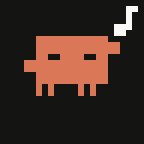<br><sub>turn finished: dancing with a music note</sub></td>
    <td align="center" width="160"><br><sub>confetti raining down while it bounces</sub></td>
    <td align="center" width="160">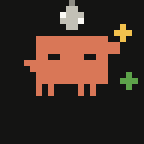<br><sub>under a disco ball, light sparkles flashing</sub></td>
  </tr>
</table>

## Development

```sh
npm run watch              # rebuild on change and restart the plugin
npm run preview -- [mood]  # render a few frames of each variant as PNGs (macOS Quick Look)
npm run gifs               # regenerate docs/animations/*.gif
```

| Path | What's in it |
| --- | --- |
| `src/art.ts` | palette, the 24×24 grid helpers, the `Draw`/`Pose`/`Variant` types and Clawd himself |
| `src/scenes/*.ts` | the animation variants, one array per mood; `index.ts` lists them all |
| `src/crab.ts` | composes one frame as SVG: crab, scene props, blink, mini crabs, status line |
| `src/actions/pet.ts` | the Stream Deck action: polling, mood logic, "Baked for", Esc detection, key press |
| `hooks/claudepet.sh` | the Claude Code hook that writes the state files |
| `scripts/` | `preview.mjs` and `gifs.mjs`, which bundle the TypeScript in memory to render frames |

### Adding a variant

Append a function to a mood's array in `src/scenes/`. It gets the frame number `f` and a `pose` to tweak, and returns an optional bounce `dy` and a `props` function that draws on top of the crab:

```ts
// waving hello, a little star blinking above
(f, pose) => {
	pose.arms = [false, f % 2 === 0];
	return { props: ({ rect }) => { if (f % 4 < 2) rect(20, 1, 1, 1, CREAM); } }; // CREAM from "../art"
},
```

Rules:

- **Deterministic in `f`:** no `Math.random()` or clocks. The same frame number always draws the same picture.
- **Stay on the 24×24 grid:** the crab sits at x4–19, y6–15.
- **Nothing below y17:** the mini crabs and the status line live down there.

Put a one-line comment above it; that's what the gallery caption uses. Then run `npm run preview -- <mood>` or `npm run gifs` to see it.

## Troubleshooting

- **The plugin doesn't appear after `streamdeck link`:** quit and restart the Stream Deck app.
- **`streamdeck restart` (and `npm run watch`) silently does nothing:** turn on developer mode with `streamdeck dev`.
- **Don't relaunch Stream Deck from inside a Claude Code shell.** It would inherit the `CLAUDE_CODE_*` environment variables. The plugin strips `CLAUDE*` variables from the sessions it opens anyway, but start Stream Deck from the Dock or Finder.
- **Don't add `"Debug": "disabled"` to the manifest's `Nodejs` block:** it makes the plugin crash-loop. Leave the key out.

## Credits

Clawd is Anthropic's mascot. claudePet is a personal, unofficial fan project and is not affiliated with or endorsed by Anthropic.
